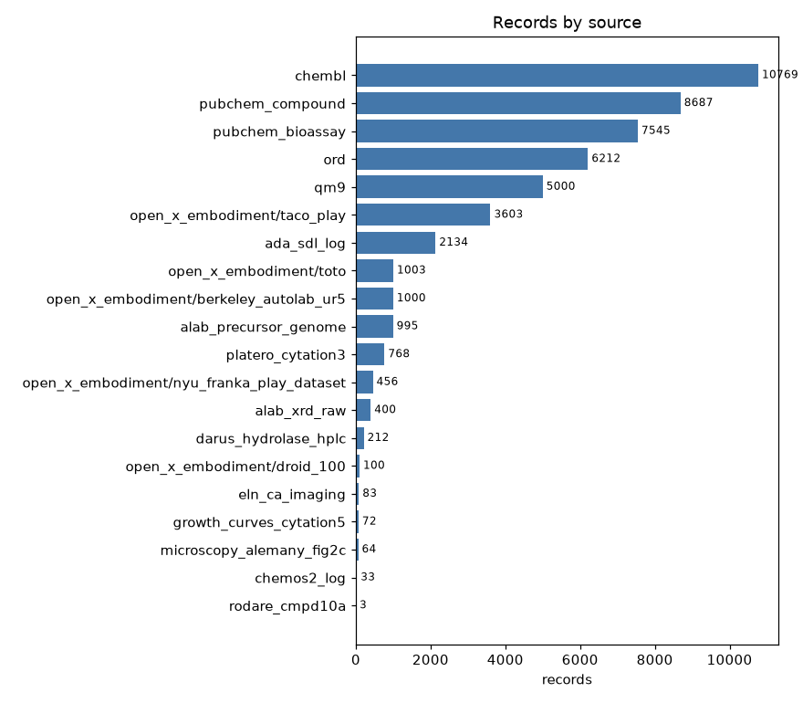
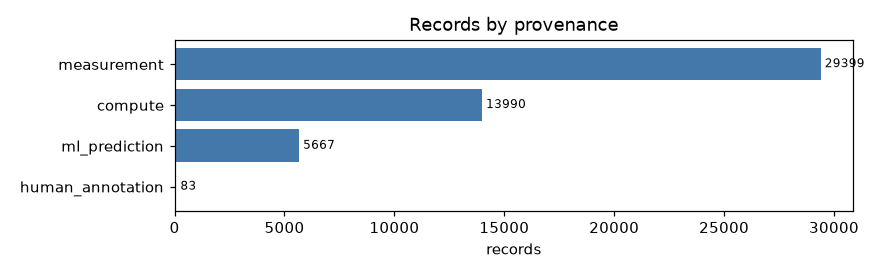
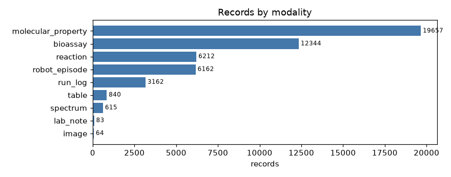
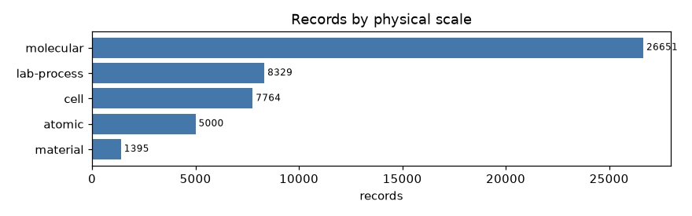
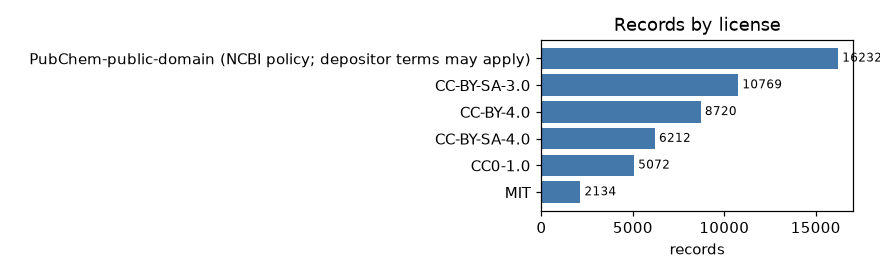
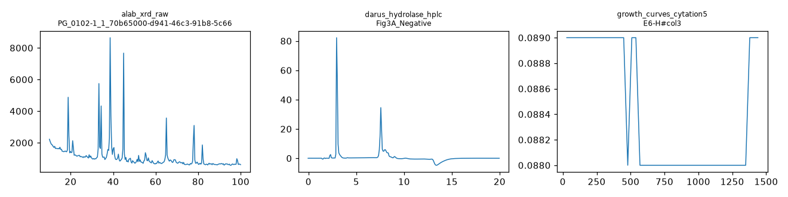

# Dataset overview (v0) — the real training data

All numbers below are computed from `data/v0/records.parquet` by `scripts/make_overview.py`.
Nothing here is synthetic: every record comes from a public source and points back to it (`source_url`).

- **records:** 49139  (invalid dropped: 0, duplicates dropped: 142)
- **splits:** {'train': 40790, 'val': 4189, 'test': 4160}  — split by leakage group (molecule scaffold, ORD dataset, robot task, A-Lab element system, ...); groups that appear in more than one split: **0**
- **annotators:** {'rule:v0': 32470, 'llm:codex/gpt-6.1-sol': 95, 'human:alab_team': 1020}  (`rule:v0` and `llm:*` are automatic, `human:*` came from the source authors)



## Source x provenance (with license)

| source | compute | human_annotation | measurement | ml_prediction | license |
|---|---:|---:|---:|---:|---|
| ada_sdl_log | 0 | 0 | 2134 | 0 | MIT |
| alab_precursor_genome | 0 | 0 | 995 | 0 | CC-BY-4.0 |
| alab_xrd_raw | 0 | 0 | 400 | 0 | CC-BY-4.0 |
| chembl | 2990 | 0 | 4799 | 2980 | CC-BY-SA-3.0 |
| chemos2_log | 0 | 0 | 33 | 0 | CC-BY-4.0 |
| darus_hydrolase_hplc | 0 | 0 | 212 | 0 | CC-BY-4.0 |
| eln_ca_imaging | 0 | 83 | 0 | 0 | CC-BY-4.0 |
| growth_curves_cytation5 | 0 | 0 | 72 | 0 | CC0-1.0 |
| microscopy_alemany_fig2c | 0 | 0 | 64 | 0 | CC-BY-4.0 |
| open_x_embodiment/berkeley_autolab_ur5 | 0 | 0 | 1000 | 0 | CC-BY-4.0 |
| open_x_embodiment/droid_100 | 0 | 0 | 100 | 0 | CC-BY-4.0 |
| open_x_embodiment/nyu_franka_play_dataset | 0 | 0 | 456 | 0 | CC-BY-4.0 |
| open_x_embodiment/taco_play | 0 | 0 | 3603 | 0 | CC-BY-4.0 |
| open_x_embodiment/toto | 0 | 0 | 1003 | 0 | CC-BY-4.0 |
| ord | 0 | 0 | 6212 | 0 | CC-BY-SA-4.0 |
| platero_cytation3 | 0 | 0 | 768 | 0 | CC-BY-4.0 |
| pubchem_bioassay | 0 | 0 | 7545 | 0 | PubChem-public-domain (NCBI policy; depositor terms may apply) |
| pubchem_compound | 6000 | 0 | 0 | 2687 | PubChem-public-domain (NCBI policy; depositor terms may apply) |
| qm9 | 5000 | 0 | 0 | 0 | CC0-1.0 |
| rodare_cmpd10a | 0 | 0 | 3 | 0 | CC-BY-4.0 |



## Modality x physical scale

| modality | atomic | cell | lab-process | material | molecular |
|---|---:|---:|---:|---:|---:|
| bioassay | 0 | 7545 | 0 | 0 | 4799 |
| image | 0 | 64 | 0 | 0 | 0 |
| lab_note | 0 | 83 | 0 | 0 | 0 |
| molecular_property | 5000 | 0 | 0 | 0 | 14657 |
| reaction | 0 | 0 | 0 | 0 | 6212 |
| robot_episode | 0 | 0 | 6162 | 0 | 0 |
| run_log | 0 | 0 | 2167 | 995 | 0 |
| spectrum | 0 | 0 | 0 | 400 | 215 |
| table | 0 | 72 | 0 | 0 | 768 |

 

## Licenses

| key | records |
|---|---:|
| PubChem-public-domain (NCBI policy; depositor terms may apply) | 16232 |
| CC-BY-SA-3.0 | 10769 |
| CC-BY-4.0 | 8720 |
| CC-BY-SA-4.0 | 6212 |
| CC0-1.0 | 5072 |
| MIT | 2134 |



## Task examples and preference pairs built from it

| key | records |
|---|---:|
| outcome / test | 400 |
| outcome / train | 4000 |
| outcome / val | 400 |
| property_qa / test | 400 |
| property_qa / train | 4000 |
| property_qa / val | 400 |
| protocol2actions / test | 400 |
| protocol2actions / train | 4000 |
| protocol2actions / val | 382 |
| provenance / test | 400 |
| provenance / train | 4000 |
| provenance / val | 400 |
| safety_failure / test | 400 |
| safety_failure / train | 4000 |
| safety_failure / val | 298 |

| key | records |
|---|---:|
| wrong_provenance / train | 4000 |
| wrong_provenance / val | 400 |
| wrong_provenance / test | 400 |
| corrupted_actions / train | 4000 |
| corrupted_actions / val | 382 |
| corrupted_actions / test | 400 |
| success_vs_failure / val | 10 |
| success_vs_failure / train | 274 |
| success_vs_failure / test | 1 |

## Raw vs cleaned: real examples

We keep both. Raw excerpts live in `data/v0/raw_samples/` (small copies or first lines of the original file).
Full raw files are re-downloaded by `scripts/ingest_messy.py` into `data/raw/` (not in git).



### ada_sdl_log

**Raw (messy) excerpt** — `data/v0/raw_samples/ada_campaign2.log.head.txt`

```
DEBUG:campaign_config:Beginning of log file
WARNING:campaign_config:DirectSoundCreate: No audio device found
WARNING:campaign_config:PyGame mixer error. No audio will be played when consumables need to be refilled.
DEBUG:ada_peripherals_private.data_parser.google_drive.GoogleDrive:Initializing GoogleDrive
DEBUG:ada_peripherals_private.data_parser.google_drive.GoogleDrive:token.pickle has been found.
DEBUG:ada_peripherals_private.data_parser.google_drive.GoogleDrive:Initializing GoogleDrive
DEBUG:ada_peripherals_private.data_parser.google_drive.GoogleDrive:token.pickle has been found.
INFO:ada_peripherals_private.campaign_controller.campaign_controller.CampaignController:Starting a new ChemOS campaign.
INFO:dropbox:Request to files/list_folder
DEBUG:urllib3.connectionpool:Starting new HTTPS connection (1): api.dropboxapi.com:443
DEBUG:urllib3.connectionpool:https://api.dropboxapi.com:443 "POST /2/files/list_folder HTTP/1.1" 200 None
INFO:dropbox:Request to files/list_folder

```

**Cleaned record**

```json
{
 "id": "ada:b6589fc6ab0dc82c",
 "source": "ada_sdl_log",
 "license": "MIT",
 "modality": "run_log",
 "provenance": "measurement",
 "physical_scale": "lab-process",
 "method": "self-driving lab controller log",
 "property": NaN,
 "value": NaN,
 "units": NaN,
 "entity": {
  "logger": "campaign_config"
 },
 "conditions": {
  "level": "DEBUG",
  "line_no": 0
 },
 "protocol_steps": [],
 "outcome": {
  "success": null,
  "metric": "event_ok",
  "value": null,
  "units": null
 },
 "annotations": []
}
```

### alab_precursor_genome

**Raw (messy) excerpt** — `data/v0/raw_samples/alab_ledger.one_sample.json`

```
{
 "sample_id": "PG_0112",
 "description": null,
 "precursors": [
  {
   "formula": "Ag2O",
   "name": "silver(i) oxide",
   "formula_clean": "Ag2O",
   "cas_number": "20667-12-3",
   "melting_point_c": 280.0,
   "sa_product_number": "221163",
   "sa_purity": 0.99,

```

**Cleaned record**

```json
{
 "id": "alab:62281a6711468bb7",
 "source": "alab_precursor_genome",
 "license": "CC-BY-4.0",
 "modality": "run_log",
 "provenance": "measurement",
 "physical_scale": "material",
 "method": "automated solid-state synthesis + XRD (A-Lab)",
 "property": "mass_recovered",
 "value": 1224.0,
 "units": "mg",
 "entity": {
  "target": "Al2Ag2H6O7",
  "precursors": [
   "Ag2O",
   "Al(OH)3"
  ],
  "elements": [
   "Al",
   "Ag",
   "H",
   "O"
  ]
 },
 "conditions": {
  "heating_temperature_C": 200.0,
  "heating_time_min": 240.0,
  "dosing_error_g": {
   "Ag2O_PG": -0.00322,
   "Al(OH)3_PG": 0.00084
  },
  "met_target_mass": false,
  "temperature_profile": {
   "t_min": [
    0.005,
    1.01,
    2.015,
    3.02,
    4.024,
    5.029,
    6.034,
    7.038,
    8.043,
    9.048,
    10.053,
    11.058,
    12.063,
    13.069,
    14.074,
    15.079,
    16.084,
    17.089,
    18.094,
    19.099,
    20.104,
    21.109,
    22.114,
    23.119,
    24.124,
    25.129,
    26.134,
    27.14,
    28.145,
    29.15,
    30.156,
    31.161,
    32.166,
    33.171,
    34.176,
    35.181,
    36.186,
    37.191,
    38.196,
    39.201,
    40.206,
    41.21,
    42.215,
    43.22,
    44.225,
    45.23,
    46.235,
    47.24,
    48.245,
    49.25,
    50.255,
    51.26,
    52.265,
    53.27,
    54.275,
    55.28,
    56.285,
    57.291,
    58.296,
    59.3,
    60.305,
    61.31,
    62.315,
    63.32,
    64.325,
    65.33,
    66.336,
    67.341,
    68.346,
    69.351,
    70.355,
    71.36,
    72.366,
    73.371,
    74.376,
    75.381,
    76.385,
    77.39,
    78.395,
    79.4
```

### alab_xrd_raw

**Raw (messy) excerpt** — `data/v0/raw_samples/PG_0102-1_1_70b65000-d941-46c3-91b8-5c66cd4b3c7e.xrdml`

```
<?xml version="1.0"?>
<xrdMeasurements xmlns="http://www.xrdml.com/XRDMeasurement/2.3" xmlns:xsi="http://www.w3.org/2001/XMLSchema-instance" xsi:schemaLocation="http://www.xrdml.com/XRDMeasurement/2.3 http://www.xrdml.com/XRDMeasurement/2.3/XRDMeasurement.xsd" status="Completed" recordIdentifier="{B01F7536-3E5B-4ED5-B307-C912AE584380}">
	<comment>
		<entry/>
	</comment>
	<sample type="To be analyzed">
		<id>PG_0102-1_1_70b65000-d941-46c3-91b8-5c66cd4b3c7e</id>
		<name></name>
		<preparedBy></preparedBy>
	</sample>
	<xrdMeasurement measurementType="Scan" status="Completed" sampleMode="Reflection">
		<usedWavelength intended="K-Alpha 1">

```

**Cleaned record**

```json
{
 "id": "alabxrd:8c4e34311411c902",
 "source": "alab_xrd_raw",
 "license": "CC-BY-4.0",
 "modality": "spectrum",
 "provenance": "measurement",
 "physical_scale": "material",
 "method": "powder XRD (Cu K-alpha)",
 "property": "xrd_pattern",
 "value": NaN,
 "units": "counts vs 2theta_deg",
 "entity": {
  "sample_id": "PG_0102-1",
  "file": "PG_0102-1_1_70b65000-d941-46c3-91b8-5c66cd4b3c7e.xrdml"
 },
 "conditions": {
  "x": [
   10.00943,
   10.36232,
   10.7152,
   11.06808,
   11.42096,
   "..."
  ],
  "y": [
   2219.0,
   2072.96863,
   1952.62353,
   1879.57647,
   1851.7098,
   "..."
  ],
  "n_points_raw": 8282,
  "max_counts": 19550.0
 },
 "protocol_steps": [],
 "outcome": {
  "success": null,
  "metric": "reaction_category=None",
  "value": null,
  "units": null
 },
 "annotations": []
}
```

### chemos2_log

**Raw (messy) excerpt** — `data/v0/raw_samples/chemos_opticslog.csv`

```
id,device_id,job_id,name,status,timestamp,location
4801,3,738,,submitted job BSBCz_23-07-24-14-40,2023-07-24 14:40:30.108814,uoft
4802,3,738,,processing job BSBCz_23-07-24-14-40,2023-07-24 14:40:30.108814,uoft
4803,3,738,,"
measurement start for BSBCz_C00523-07-20-17-38",2023-07-24 14:40:30.108814,uoft
4804,3,738,,valve connection opened,2023-07-24 14:40:30.108814,uoft
4805,3,738,,23-07-24-14-40: washing selector to pump line with solvent,2023-07-24 14:40:30.108814,uoft
4806,3,738,,Discard selector to pump volumes,2023-07-24 14:40:30.108814,uoft
4807,3,738,,Switch selector to position 5,2023-07-24 14:40:30.108814,uoft
4808,3,738,,Draw 0.194 ml of sample,2023-07-24 14:40:30.108814,uoft
4809,3,738,,Switch selector to position 1,2023-07-24 14:40:30.108814,uoft
4810,3,738,,valve connection closed,2023-07-24 14:40:30.108814,uoft

```

**Cleaned record**

```json
{
 "id": "chemos:5f4ad80eeb78cb95",
 "source": "chemos2_log",
 "license": "CC-BY-4.0",
 "modality": "run_log",
 "provenance": "measurement",
 "physical_scale": "lab-process",
 "method": "ChemOS 2.0 closed-loop optics log",
 "property": NaN,
 "value": NaN,
 "units": NaN,
 "entity": {
  "job_id": "738",
  "device_id": "3"
 },
 "conditions": {
  "timestamp": "2023-07-24 14:40:30.108814",
  "location": "uoft"
 },
 "protocol_steps": [],
 "outcome": {
  "success": null,
  "metric": "status",
  "value": null,
  "units": null
 },
 "annotations": []
}
```

### rodare_cmpd10a

**Raw (messy) excerpt** — `data/v0/raw_samples/nmr_13c_10a.log.txt`

```
Wed Jul  3 11:43:24 2024: Experiment started
Wed Jul  3 11:46:37 2024: BS 1 completed
Wed Jul  3 11:49:49 2024: BS 2 completed
Wed Jul  3 11:53:01 2024: BS 3 completed
Wed Jul  3 11:56:13 2024: BS 4 completed
Wed Jul  3 11:59:25 2024: BS 5 completed
Wed Jul  3 12:02:37 2024: BS 6 completed
Wed Jul  3 12:05:49 2024: BS 7 completed
Wed Jul  3 12:09:01 2024: BS 8 completed
Wed Jul  3 12:12:13 2024: BS 9 completed
Wed Jul  3 12:15:25 2024: BS 10 completed
Wed Jul  3 12:18:37 2024: BS 11 completed

```

**Cleaned record**

```json
{
 "id": "rodare:712bd818476f0935",
 "source": "rodare_cmpd10a",
 "license": "CC-BY-4.0",
 "modality": "spectrum",
 "provenance": "measurement",
 "physical_scale": "molecular",
 "method": "13C NMR FID (Varian)",
 "property": "nmr_fid_blocks_completed",
 "value": 21.0,
 "units": "blocks",
 "entity": {
  "compound": "aryl-boronic ester 10a"
 },
 "conditions": {
  "spectrometer_freq_MHz": 100.5784014
 },
 "protocol_steps": [],
 "outcome": {
  "success": false,
  "metric": "acquisition_completed",
  "value": null,
  "units": null
 },
 "annotations": [
  {
   "key": "failure_reason",
   "value": "acquisition_aborted",
   "annotator": "rule:v0",
   "auto": true
  }
 ]
}
```

### platero_cytation3

**Raw (messy) excerpt** — `data/v0/raw_samples/platero_plate1.xlsx`

```
(binary file kept at data/v0/raw_samples/platero_plate1.xlsx)
```

**Cleaned record**

```json
{
 "id": "platero:fd33b69e96d8c3e8",
 "source": "platero_cytation3",
 "license": "CC-BY-4.0",
 "modality": "table",
 "provenance": "measurement",
 "physical_scale": "molecular",
 "method": "plate reader fluorescein fluorescence (Ex485/Em528) + OD600",
 "property": "fluorescence_gain60",
 "value": 4.0,
 "units": "RFU",
 "entity": {
  "plate": "Plate1",
  "well": "A1",
  "well_id": "BLK",
  "control": "blank"
 },
 "conditions": {
  "conc_dil": null,
  "reads": {
   "F:G50:485,528": 14,
   "F:G60:485,528": 4,
   "F:G70:485,528": 25,
   "F:G80:485,528": 57,
   "OD:600": 0.04
  },
  "plate_temp_C_range": [
   33.3,
   36.7
  ]
 },
 "protocol_steps": [],
 "outcome": {
  "success": null,
  "metric": null,
  "value": null,
  "units": null
 },
 "annotations": []
}
```

### growth_curves_cytation5

**Raw (messy) excerpt** — `data/v0/raw_samples/growth_curves.xlsx`

```
(binary file kept at data/v0/raw_samples/growth_curves.xlsx)
```

**Cleaned record**

```json
{
 "id": "growth:d7ae72325429ad2f",
 "source": "growth_curves_cytation5",
 "license": "CC0-1.0",
 "modality": "table",
 "provenance": "measurement",
 "physical_scale": "cell",
 "method": "kinetic OD600 growth curve, 30C",
 "property": "max_OD600",
 "value": 0.089,
 "units": "OD",
 "entity": {
  "strain_well_label": "E6-H",
  "control": null
 },
 "conditions": {
  "t_min": [
   29.166666666666668,
   59.166666666666664,
   89.16666666666667,
   119.16666666666667,
   149.16666666666666,
   179.16666666666666,
   209.16666666666666,
   239.16666666666666,
   269.1666666666667,
   299.1666666666667,
   329.1666666666667,
   359.1666666666667,
   389.1666666666667,
   419.1666666666667,
   449.1666666666667,
   479.1666666666667,
   509.1666666666667,
   539.1666666666666,
   569.1666666666666,
   599.1666666666666,
   629.1666666666666,
   659.1666666666666,
   689.1666666666666,
   719.1666666666666,
   749.1666666666666,
   779.1666666666666,
   809.1666666666666,
   839.1666666666666,
   869.1666666666666,
   899.1666666666666,
   929.1666666666666,
   959.1666666666666,
   989.1666666666666,
   1019.1666666666666,
   1049.1666666666667,
   1079.1666666666667,
   1109.1666666666667,
   1139.1666666666667,
   1169.1666666666667,
   1199.1666666666667,
   1229.1666666666667,
   1259.1666666666667,
   1289.1666666666667,
   1319.1666666666667,
   1349.1666666666667,
   1379.1666666666667,
   1409.1666666666667,
   1439.1666666666667
  ],
  "od600": [
   0.089,
   0.089,
   0.089,
   0.089,
   0.089,
   0.089,
   0.089,
   0.089,
   0.089,
   0.089,
   0.089,
   0.089,
   0.089
```

### eln_ca_imaging

**Raw (messy) excerpt** — `data/v0/raw_samples/eln_ca_imaging.html`

```
<h1 style="margin-bottom: 0.49cm; line-height: 100%; background: #ffffff;"><span style="color: #797979;"><span style="font-family: Lato, serif;"><span style="font-size: x-large;"><span lang="en">General Information</span></span></span></span></h1>
<table border="1" style="border-collapse: collapse; width: 100%;">
<tr>
<td style="width: 9.27949%;"><strong>Researcher</strong></td>
<td style="width: 90.2111%;"><span class="tags">Susanne Stählke</span></td>
</tr>
<tr>
<td style="width: 9.27949%;"><strong>Objective</strong></td>
<td style="width: 90.2111%;">Intracellular calcium dynamic caused by electric fields</td>
</tr>
</table>
<h1 style="margin-bottom: 0.49cm; line-height: 100%; background: #ffffff;"><span style="color: #797979;"><span style="font-family: Lato, serif;"><span style="font-size: x-large;"><span lang="en">Protocol</span></span></span></span></h1>

```

**Cleaned record**

```json
{
 "id": "eln:b6589fc6ab0dc82c",
 "source": "eln_ca_imaging",
 "license": "CC-BY-4.0",
 "modality": "lab_note",
 "provenance": "human_annotation",
 "physical_scale": "cell",
 "method": "electronic lab notebook (free text)",
 "property": NaN,
 "value": NaN,
 "units": NaN,
 "entity": {},
 "conditions": {},
 "protocol_steps": [],
 "outcome": {
  "success": null,
  "metric": null,
  "value": null,
  "units": null
 },
 "annotations": []
}
```

### ord

**Raw (messy) excerpt** — `None`

```
(clean API/benchmark source; original at https://open-reaction-database.org/id/ord-bf7bea643a444b298f78649dd3b73dba)
```

**Cleaned record**

```json
{
 "id": "ord:641705a61b6aab02",
 "source": "ord",
 "license": "CC-BY-SA-4.0",
 "modality": "reaction",
 "provenance": "measurement",
 "physical_scale": "molecular",
 "method": "reported isolated/assay yield",
 "property": "yield",
 "value": 54.6,
 "units": "%",
 "entity": {
  "reactants": [
   "O",
   "COC=1C=C(C=CC1OC)C1=CC(N(C(N1)=O)C)=NC1=C(C=C(C=C1C)C)C",
   "CC(C)([O-])C.[K+]",
   "CC(C)([O-])C.[K+]",
   "C(C)I",
   "C(C)I"
  ],
  "reagents": [],
  "products": [
   "COC=1C=C(C=CC1OC)C1=CC(N(C(N1CC)=O)C)=NC1=C(C=C(C=C1C)C)C"
  ],
  "reaction_type": null,
  "ord_dataset": "ord_dataset-166e12c0a91ded488db9e3129c1ad034"
 },
 "conditions": {
  "reaction_time": "3 hour",
  "solvents": [
   "CN(C=O)C"
  ]
 },
 "protocol_steps": [
  {
   "action": "add",
   "params": {
    "duration": "1 H",
    "amounts": [
     "2.73 g",
     "1.0 g",
     "27 ml",
     "1.2 ml"
    ]
   }
  },
  {
   "action": "stir",
   "params": {
    "duration": "1 H",
    "amounts": [
     "2.73 g",
     "1.0 g",
     "27 ml",
     "1.2 ml"
    ]
   }
  },
  {
   "action": "add",
   "params": {
    "amounts": [
     "1.1 g",
     "0.57 ml"
    ]
   }
  },
  {
   "action": "stir",
   "params": {
    "duration": "2 hours"
   }
  },
  {
   "action": "transfer",
   "params": {
    "duration": "2 hours"
   }
  },
  {
   "action": "filter",
   "params": {
    "amounts": [
     "15 ml"
    ]
   }
  },
  {
   "action": "add",
   "params": {
    "amounts": [
     "15 ml"
    ]
   }
  },
  {
   "action": "reflux",
   "params": {
    "duration": "5 hours"
   }
  },
  {
   "action": "cool",
   "params": {}
  },
  
```

### open_x_embodiment/toto

**Raw (messy) excerpt** — `None`

```
(clean API/benchmark source; original at https://huggingface.co/datasets/lerobot/toto)
```

**Cleaned record**

```json
{
 "id": "robot:174681251590a283",
 "source": "open_x_embodiment/toto",
 "license": "CC-BY-4.0",
 "modality": "robot_episode",
 "provenance": "measurement",
 "physical_scale": "lab-process",
 "method": "teleoperated demonstration",
 "property": "episode_duration",
 "value": 7.63,
 "units": "s",
 "entity": {
  "instruction": "pour"
 },
 "conditions": {
  "fps": 30,
  "hf_license_tag": "mit",
  "action_summary": {
   "n_frames": 229,
   "duration_s": 7.63,
   "action_dim": 7,
   "action_mean": [
    0.4618000090122223,
    -0.21279999613761902,
    0.33719998598098755,
    -0.9050999879837036,
    0.09319999814033508,
    -0.09149999916553497,
    0.0
   ],
   "action_std": [
    0.06120000034570694,
    0.025699999183416367,
    0.08429999649524689,
    0.13420000672340393,
    0.19470000267028809,
    0.20270000398159027,
    0.0
   ],
   "gripper_toggles": 0
  }
 },
 "protocol_steps": [
  {
   "action": "move",
   "params": {
    "to": "container"
   }
  },
  {
   "action": "grasp",
   "params": {}
  },
  {
   "action": "move",
   "params": {
    "to": "receptacle"
   }
  },
  {
   "action": "pour",
   "params": {}
  },
  {
   "action": "place",
   "params": {}
  },
  {
   "action": "release",
   "params": {}
  }
 ],
 "outcome": {
  "success": null,
  "metric": "demo_completed",
  "value": null,
  "units": null
 },
 "annotations": [
  {
   "key": "step_type",
   "value": [
    "motion",
    "manipulation",
    "motion",
    "liquid_handling",
    "manipulation",
    "manipulation"
   ],
   "annotator": "rule:v0",
   "auto": true
  },
  {
   "key": "safety_level",
   "value
```

### chembl

**Raw (messy) excerpt** — `None`

```
(clean API/benchmark source; original at https://www.ebi.ac.uk/chembl/compound_report_card/CHEMBL68920/)
```

**Cleaned record**

```json
{
 "id": "chembl:0b5ad178c4f6dc1c",
 "source": "chembl",
 "license": "CC-BY-SA-3.0",
 "modality": "bioassay",
 "provenance": "measurement",
 "physical_scale": "molecular",
 "method": "IC50 (single protein format)",
 "property": "IC50",
 "value": 41.0,
 "units": "nM",
 "entity": {
  "smiles": "Cc1cc(C)c(/C=C2\\C(=O)Nc3ncnc(Nc4ccc(F)c(Cl)c4)c32)[nH]1",
  "molecule_chembl_id": "CHEMBL68920",
  "target_chembl_id": "CHEMBL203",
  "target": "Epidermal growth factor receptor",
  "assay_chembl_id": "CHEMBL674637",
  "assay_description": "Inhibitory activity towards tyrosine phosphorylation for the epidermal growth factor-receptor kinase"
 },
 "conditions": {
  "assay_type": "B",
  "organism": "Homo sapiens",
  "pchembl_value": 7.39,
  "document_year": 2002
 },
 "protocol_steps": [],
 "outcome": {
  "success": true,
  "metric": "pchembl>=6 (active)",
  "value": 7.39,
  "units": null
 },
 "annotations": []
}
```

### qm9

**Raw (messy) excerpt** — `None`

```
(clean API/benchmark source; original at https://doi.org/10.6084/m9.figshare.c.978904.v5)
```

**Cleaned record**

```json
{
 "id": "qm9:7b2de9bcf66d3638",
 "source": "qm9",
 "license": "CC0-1.0",
 "modality": "molecular_property",
 "provenance": "compute",
 "physical_scale": "atomic",
 "method": "DFT B3LYP/6-31G(2df,p)",
 "property": "gap",
 "value": 0.2301,
 "units": "Ha",
 "entity": {
  "smiles": "O=C1C2CCCC1C=C2"
 },
 "conditions": {},
 "protocol_steps": [],
 "outcome": {
  "success": null,
  "metric": null,
  "value": null,
  "units": null
 },
 "annotations": []
}
```


## Browse more

`data/v0/sample.jsonl` has 20 full records per source (one JSON per line). Quick look:

```python
import pandas as pd
df = pd.read_parquet('data/v0/records.parquet')
df.groupby(['source','provenance']).size()
```
